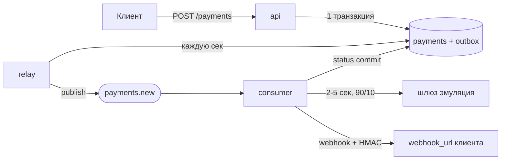

# Архитектура Payment Processing Service

Полное описание устройства сервиса: слои, сущности, поток платежа и схема надёжности.
Смотри также: `ARCHITECTURE.MD` (исходный план структуры), `README.md` (запуск и примеры).
Схема архитектуры — `docs/architecture.excalidraw` (локально, в репозиторий не входит).


## Общая картина

Сервис принимает запрос на оплату, асинхронно обрабатывает его через эмуляцию
платёжного шлюза и уведомляет клиента через webhook. Состоит из четырёх
независимых процессов (контейнеров):

| Процесс | Роль | Точка входа |
|---|---|---|
| **api** | HTTP-интерфейс (FastAPI) | `payment.entrypoints.api.app:app` |
| **relay** | Публикация событий из outbox в RabbitMQ | `payment.entrypoints.relay.runner` |
| **consumer** | Обработка платежа (FastStream) | `payment.entrypoints.consumer.app` |
| **migrate** | Миграции Alembic (одноразовый) | `alembic upgrade head` |

## Слои (правило: зависимости направлены только внутрь)

```
entrypoints → bootstrap → adapters → application → domain
                              ↘ application/ports (интерфейсы)
```

### 1. `src/payment/domain/` — чистая бизнес-логика

Ни одной строчки про FastAPI/SQLAlchemy/брокер. Слой можно тестировать без Docker.

- **`model/payment.py` — агрегат `Payment`** (Aggregate Root). Единственный владелец
  статуса. Бизнес-правила: новый платёж всегда `pending`; финальный статус
  (`succeeded`/`failed`) поменять нельзя (`InvalidStatusTransition`). Каждое изменение
  статуса порождает доменное событие, которое собирается в буфер (`collect_events`).
- **`model/value_objects.py`** — неизменяемые обёртки с валидацией:
  - `Money(amount: Decimal, currency)` — только положительная сумма, нормализация до
    4 знаков (соответствует `Numeric(19,4)` в БД). Никогда не `float`.
  - `IdempotencyKey` — непустая строка ≤ 255 символов, уникальный ключ защиты от дублей.
  - `WebhookUrl` — только http/https.
  - `PaymentId` — UUID.
- **`model/enums.py`** — `Currency` (RUB/USD/EUR), `PaymentStatus` (pending/succeeded/failed).
- **`model/fingerprint.py`** — `compute_fingerprint()`: sha256 канонического JSON тела
  (sort_keys, separators). Используется API-слоем: тот же `Idempotency-Key` + тот же
  fingerprint → вернуть существующий платёж; другой fingerprint → `409 Conflict`.
- **`events.py`** — доменные события: `PaymentCreated`, `PaymentSucceeded`, `PaymentFailed`.
- **`exceptions.py`** — доменные ошибки (`InvalidMoney`, `InvalidStatusTransition`, ...).
- **`services/retry_policy.py`** — `ExponentialBackoffRetryPolicy`: max_attempts, delay =
  base · factor^(attempt−1). Чистая математика ретраев, используется webhook-логикой.

### 2. `src/payment/application/` — сценарии и порты

- **`use_cases/`** — каждый сценарий = один шаг бизнеса:
  - `create_payment.py` (`CreatePayment`) — идемпотентное создание: платёж **+ запись
    outbox в одной транзакции** (outbox pattern). Повтор ключа с тем же телом → тот же
    платёж (`created=False`), с другим телом → `IdempotencyConflict`.
  - `process_payment.py` (`ProcessPayment`) — загрузка платежа → шлюз → статус →
    **commit** → webhook. Статус коммитится ДО отправки webhook: недоступный webhook
    не перекатывает платёж в очередь. Повторное сообщение по уже обработанному
    платежу — ack без изменений (at-least-once-безопасность).
  - `get_payment.py` (`GetPayment`) — чтение.
  - `publish_outbox.py` (`PublishOutbox`) — пакет несент записей outbox → публикация →
    mark_sent. Падение брокера оставляет записи несент.
- **`ports/`** — интерфейсы («розетки»), протоколы Python:
  `repositories.py` (`AbstractUnitOfWork`, `PaymentRepository`, `OutboxRepository`),
  `payment_gateway.py`, `webhook_sender.py`, `message_publisher.py`.
- **`dto.py`** — Command/Result-объекты (не Pydantic-схемы API).
- **`exceptions.py`** — `PaymentNotFound`, `IdempotencyConflict`.

### 3. `src/payment/adapters/` — реализации портов на конкретных технологиях

- **`persistence/`**
  - `orm.py` — таблицы `payments` и `outbox` (imperative core, без декларативных моделей).
  - `database.py` — `make_engine` / `make_sessionmaker` (async).
  - `unit_of_work.py` — `SqlAlchemyUnitOfWork`: сессия на входе в контекст,
    `commit()` атомарен для payments + outbox.
  - `repositories/payment.py` — ручной маппинг домена ↔ строки БД.
  - `repositories/outbox.py` — `fetch_unsent` с `FOR UPDATE SKIP LOCKED`
    (безопасно при нескольких relay-процессах).
- **`messaging/`**
  - `topology.py` — очередь `payments.new`, retry-очереди `payments.new.retry.N`
    (TTL = 1·2^(N−1) с, dead-letter обратно в main), DLQ `payments.dlq`.
  - `publisher.py` — `FastStreamPublisher` (реализация `MessagePublisher`).
  - `schemas.py` — Pydantic-схема payload сообщения.
- **`gateway/fake_gateway.py`** — эмуляция шлюза: 2–5 сек, 90% успех / 10% ошибка.
- **`webhook/`** — `http_sender.py` (httpx: сериализация + HMAC + POST с таймаутом),
  `signer.py` (`X-Signature: t=<ts>,v1=<hex>`, окно по времени), `guard.py` (SSRF).

### 4. `src/payment/entrypoints/` — двери в мир

- **`api/`** — FastAPI: роутер `/api/v1/payments`, dependency `X-API-Key` (401),
  обработчики ошибок (404/409), Pydantic-схемы. `create_app()` собирает приложение.
- **`consumer/`** — подписчик на `payments.new`. Один обработчик делает всё:
  `ProcessPayment`. Инфраструктурный сбой (БД и т.п.) → публикация в retry-очередь
  `attempt` (TTL) → dead-letter обратно в main; после 3 попыток → `payments.dlq`.
  Попытка считается по заголовкам `x-death`.
- **`relay/`** — бесконечный цикл: раз в `PAYMENT_RELAY_INTERVAL` сек пакет outbox
  → RabbitMQ. Корректное завершение по SIGINT/SIGTERM. Политика retry/DLQ —
  в адаптере `adapters/messaging/routing.py`.
- **`bootstrap.py`** — composition root (`Container`): единственное место сборки
  зависимостей. Use case'ы создаются **на запрос/сообщение** — UoW хранит сессию,
  общий экземпляр смешал бы транзакции параллельных запросов.

## Сущности и таблицы

### `payments`

| Поле | Тип в БД | Домен |
|---|---|---|
| id | UUID PK | `PaymentId` |
| amount | Numeric(19,4) | `Money.amount` |
| currency | varchar(3) | `Money.currency` |
| description | text | str |
| metadata | JSONB | dict |
| status | varchar(16) | `PaymentStatus` |
| fingerprint | varchar(64) | sha256 тела запроса (для 409) |
| idempotency_key | varchar(255) UNIQUE | `IdempotencyKey` |
| webhook_url | text | `WebhookUrl` |
| failure_reason | text | причина ошибки шлюза |
| created_at / processed_at | timestamptz | даты создания/обработки |

### `outbox`

| Поле | Тип | Назначение |
|---|---|---|
| id | UUID PK | идентификатор записи |
| aggregate_id | varchar(64) | id платежа |
| event_type | varchar(64) | `payment.created` |
| payload | JSONB | тело сообщения для брокера |
| created_at | timestamptz | порядок публикации |
| sent / sent_at | bool / timestamptz | журнал доставки |

Индекс `ix_outbox_unsent (sent, created_at)` — поллинг relay'я.

## Поток платежа (счастливый путь)



1. **POST /api/v1/payments** → `202 Accepted`, `payment_id`, статус `pending`.
2. В той же транзакции: строка `payments` + строка `outbox`.
3. **relay** публикует событие в `payments.new`, помечает `sent`.
4. **consumer** вызывает шлюз, меняет статус, коммитит, отправляет webhook.
5. Клиент читает статус через **GET /api/v1/payments/{id}**.

## Гарантии доставки

| Механизм | Реализация |
|---|---|
| Outbox pattern | Событие в outbox в той же транзакции, что и платёж; relay публикует позже |
| Идемпотентность | unique index на `idempotency_key` + fingerprint тела → 409 на конфликт; consumer идемпотентен к дублям |
| Retry consumer'а | очереди `*.retry.N` с `x-message-ttl`, dead-letter обратно в `payments.new`; до 3 попыток |
| DLQ | после 3 попыток → `payments.dlq`; из main — по `x-dead-letter` |
| Retry webhook | 3 попытки с экспоненциальной задержкой в `ProcessPayment` (исход на статус не влияет) |

## Тесты

- `tests/unit/domain/` — value objects, агрегат, переходы статусов, fingerprint, retry policy.
- `tests/unit/application/` — use cases на fake-портах (`tests/fakes/`).
- Адаптеры и entrypoints — смоук-импорт + e2e в docker compose (см. README).

## Как запустить

```bash
docker compose up --build     # postgres, rabbitmq, api, relay, consumer, migrate
```
Swagger: http://localhost:8000/docs · RabbitMQ UI: http://localhost:15673
